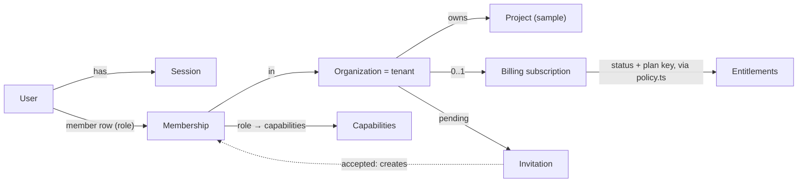

# Domain model

How the foundation's concepts relate, who decides what, and what each lifecycle can leave half-done. Read it before changing anything about identity, tenancy, access, billing or deletion. Definitions stay in the [glossary](../glossary.md); rules stay in [`AGENTS.md`](../../AGENTS.md) and the ADRs linked here. Code paths below are as of the commit this page was last changed in; the files are the record.

## Concepts and where they live

The same relationships in words: a **user** has sessions and, for each organization they belong to, one **membership** (a `member` row with a role). The **organization** is the tenant; it owns its **projects** and at most one **billing subscription**, and it has pending **invitations**, each of which creates a membership only when its recipient accepts. A membership's **role** maps to **capabilities**; the subscription's status and plan map, through the billing policy, to **entitlements**.

| Concept                     | Owned by                                            | Table (`packages/db/src/schema/`)                                     | Code that decides                                                                                                                                                                           |
| --------------------------- | --------------------------------------------------- | --------------------------------------------------------------------- | ------------------------------------------------------------------------------------------------------------------------------------------------------------------------------------------- |
| User, account, session      | Better Auth (identity, ADR-0005)                    | `user`, `account`, `session`, `verification` (`auth.ts`, generated)   | [`packages/auth`](../../packages/auth/src/auth.ts), [`server/auth.ts`](../../apps/app/src/server/auth.ts)                                                                                   |
| Organization (tenant)       | Better Auth                                         | `organization`                                                        | Better Auth's organization plugin; our server functions in [`modules/organizations/service.ts`](../../apps/app/src/modules/organizations/service.ts)                                        |
| Membership and role         | Better Auth stores it; **we** decide what it allows | `member`                                                              | [`server/context.ts`](../../apps/app/src/server/context.ts) (membership), [`server/permissions.ts`](../../apps/app/src/server/permissions.ts) (capabilities)                                |
| Invitation                  | Better Auth                                         | `invitation`                                                          | [`modules/organizations/service.ts`](../../apps/app/src/modules/organizations/service.ts) (invite, revoke, accept)                                                                          |
| Project                     | the foundation (sample tenant resource)             | `project` ([`projects.ts`](../../packages/db/src/schema/projects.ts)) | [`modules/projects/service.ts`](../../apps/app/src/modules/projects/service.ts), `projects()` in [`packages/db/src/tenancy.ts`](../../packages/db/src/tenancy.ts)                           |
| Subscription                | the provider (Polar) is the source; we keep a copy  | `billing_subscription`, `billing_webhook_event`                       | [`modules/billing/webhook.ts`](../../apps/app/src/modules/billing/webhook.ts) writes it; `applyBillingEvent` in [`packages/db/src/billing.ts`](../../packages/db/src/billing.ts)            |
| Entitlements                | computed, never stored                              | none                                                                  | [`billing/policy.ts`](../../apps/app/src/modules/billing/policy.ts) (`entitlementsFor`), [`billing/entitlements.ts`](../../apps/app/src/modules/billing/entitlements.ts) (`entitlementsIn`) |
| Checkout and deletion gates | the foundation (ADR-0043, ADR-0044)                 | `billing_checkout_gate`, `billing_access_gate`, `user_deletion`       | [`packages/db/src/billing.ts`](../../packages/db/src/billing.ts), [`account-deletion.ts`](../../packages/db/src/account-deletion.ts), [`server/auth.ts`](../../apps/app/src/server/auth.ts) |

Project is the foundation's example of a tenant-owned resource, not a product concept ([glossary](../glossary.md#repository)). A product replaces or adds to it.

## How a request is authorized

Every tenant request takes the same steps, in this order. Each step is a rule; the files are where it runs.

| Step                                              | What happens                                                                                                                       | Answer when it fails                                                                  | Source                                                                                                                               |
| ------------------------------------------------- | ---------------------------------------------------------------------------------------------------------------------------------- | ------------------------------------------------------------------------------------- | ------------------------------------------------------------------------------------------------------------------------------------ |
| 1. Input                                          | The server function parses its input with a strict Zod contract; `tenant` is a slug, `organizationId` is never accepted            | malformed `tenant`: **404**; anything else: **400**                                   | [`server/errors.ts`](../../apps/app/src/server/errors.ts) `parseInput`, invariants 1 and 9                                           |
| 2. Session                                        | Better Auth reads the session from the request's cookies                                                                           | **401**                                                                               | `getTenantContext` in [`server/context.ts`](../../apps/app/src/server/context.ts)                                                    |
| 3. Selector → organization                        | The slug selects an organization; it grants nothing                                                                                | unknown slug: **404**                                                                 | same                                                                                                                                 |
| 4. Membership                                     | The user must have a `member` row in that organization, read uncached on every call                                                | not a member: **404** (indistinguishable from step 3)                                 | same; [ADR-0004](../adr/0004-uncached-hyperdrive-binding.md), [ADR-0010](../adr/0010-path-based-tenancy.md)                          |
| 5. Resource in this tenant                        | For an operation on an id, the resource must exist in this tenant, checked before the role                                         | another tenant's or unknown id: **404**                                               | `scoped` in [`modules/projects/service.ts`](../../apps/app/src/modules/projects/service.ts)                                          |
| 6. Capability                                     | `authorize(ctx, capability)` asks the role → capability matrix                                                                     | **403** (the member already knows the tenant exists)                                  | [`server/permissions.ts`](../../apps/app/src/server/permissions.ts), invariant 5                                                     |
| 7. Entitlement (where a limit or feature applies) | The plan's limits and features, from `entitlementsIn(db, ctx.orgId)` or, for a count-then-insert, read under the organization lock | **403** with the plan's limit (projects); 403 "no free seats" (invitation acceptance) | [`billing/entitlements.ts`](../../apps/app/src/modules/billing/entitlements.ts), `createWithinLimit`, invariant 6, ADR-0020          |
| 8. Data access                                    | Repositories take `ctx`, run each statement in `inTenant` and filter by `ctx.orgId`                                                | another tenant's row is simply not found                                              | [`packages/db/src/tenancy.ts`](../../packages/db/src/tenancy.ts), [ADR-0040](../adr/0040-tenant-row-level-security.md) decisions 1–4 |

What these steps don't do:

- **The active organization is not authority.** `activeOrganizationId` only picks the landing page; the slug in the URL or input decides which tenant is asked for, and membership decides whether the answer is anything but 404 (invariant 1).
- **The UI's capabilities are hints.** The tenant layout reads `capabilities` to hide links and buttons (`getTenant`); every server function checks again (invariant 4).
- **Subscription status never authorizes.** Code asks entitlements, never a status or a plan name; only `policy.ts` maps status to plan (invariant 6).
- **Row-level security isn't enforced.** ADR-0040's policies (decisions 5–6) are proposed, not in force (roadmap M4). Today the boundary is the repository filter, with the transaction-local tenant context and `GuardedClient` as defense in depth.

Tests that prove these: [`tenancy.test.ts`](../../apps/app/test/tenancy.test.ts) (steps 2–5, 8, cross-tenant by URL and input), [`roles.test.ts`](../../apps/app/test/roles.test.ts) (step 6, one case per role), [`billing.test.ts`](../../apps/app/test/billing.test.ts) (step 7), [`database-isolation.test.ts`](../../apps/app/test/database-isolation.test.ts), and [`e2e/slice.spec.ts`](../../apps/app/e2e/slice.spec.ts) through real URLs ([`docs/testing.md`](../testing.md#tenant-isolation)).

### Roles at a glance

The matrix in [`server/permissions.ts`](../../apps/app/src/server/permissions.ts) is the record, with the owner decisions behind it in its comment. In short: every member reads, creates and updates projects and sees the member list; owners and admins also delete projects, invite, manage non-owner members and rename the organization; only an owner manages paid billing, transfers ownership or deletes the organization. Better Auth's own `/api/auth/organization/*` endpoints enforce its default roles separately, kept consistent with the matrix. A role string can hold several comma-separated roles; unknown roles grant nothing.

## Lifecycles

Each row says what starts the change, what state holds the truth, what the person sees, and what can be left partly done or unknown. "Unknown" means the system can't tell, not that nobody has looked.

### Invitation

| Stage   | Trigger                                                                                 | Authoritative state                                                         | What the person sees                                                            | Failure or partial outcome                                                                                                                                                                                                                               |
| ------- | --------------------------------------------------------------------------------------- | --------------------------------------------------------------------------- | ------------------------------------------------------------------------------- | -------------------------------------------------------------------------------------------------------------------------------------------------------------------------------------------------------------------------------------------------------- |
| Invite  | owner or admin (`member:invite`), invite page                                           | `invitation` row, status pending, Better Auth's expiry                      | the inviter gets the link back as well as the email (`inviteMember` returns it) | Pending invitations are capped by the plan's free seats (`invitationLimit`). An email that fails or is disabled doesn't undo the invitation: the inviter still has the link ([email](../integrations/email.md)).                                         |
| Pending | time                                                                                    | same                                                                        | owners and admins see unexpired pending invitations on the members page         | Expiry is Better Auth's default (`invitationExpiresIn`, not set here: 48 hours in the installed 1.7.17). Expired ones disappear from the list.                                                                                                           |
| Revoke  | owner or admin, members page                                                            | conditional update to canceled in `packages/db` (`cancelPendingInvitation`) | the row leaves the list                                                         | An invitation accepted in the same moment stays accepted: the write only cancels a pending one (404 otherwise).                                                                                                                                          |
| Accept  | the recipient, signed in with the invited address and verified email, on `/invite/<id>` | a new `member` row                                                          | redirected to the organization's projects page                                  | Wrong account, unknown, expired, revoked or already used: the **same 404**, on purpose. The plan's seat limit: 403 "no free seats". Simultaneous acceptances can exceed the cap by their number (accepted for flat pricing, comment in `packages/auth`). |

The acceptance page shows only the signed-in email, not the organization, because a preview would tell a visitor that the invitation is valid. Changing that needs an owner decision on disclosure ([invitations pattern](../design-system/patterns/invitations-and-access.md)).

### Ownership transfer and owner changes

| Stage                         | Trigger                                                             | Authoritative state                                               | What the person sees               | Failure or partial outcome                                                                                                                                                                                                                                                     |
| ----------------------------- | ------------------------------------------------------------------- | ----------------------------------------------------------------- | ---------------------------------- | ------------------------------------------------------------------------------------------------------------------------------------------------------------------------------------------------------------------------------------------------------------------------------ |
| Transfer                      | an owner (`organization:transfer`), settings, confirmed in a dialog | two Better Auth role updates: target → owner, then caller → admin | toast "Ownership transferred to …" | Not atomic: the promotion comes first, so a failure between the two leaves **two owners, never none**, with a message saying so; a retry finishes (`transferOwnership`).                                                                                                       |
| Any owner demotion or removal | role change, removal, leave, deletion                               | `member` rows, guarded by the `member_keeps_owner` trigger        | a 409 if it would leave no owner   | The guard refuses at commit at READ COMMITTED ([ADR-0043](../adr/0043-owner-guard-and-deletion-gate.md) decision 1). Billing access is revoked before and granted after each change ([ADR-0022](../adr/0022-polar-merchant-of-record.md)); a failed revoke refuses the change. |
| Leave                         | any member                                                          | Better Auth leave                                                 | back to the start page             | A sole owner is refused (409) before anything else runs.                                                                                                                                                                                                                       |

Creating an organization isn't covered by the guard (two separate inserts in Better Auth): a crash between them leaves an organization without an owner that nobody can reach (ADR-0043, accepted). The runbook's ownerless query finds them.

### Billing

The four states below are different things; none of them implies the next ([billing integration](../integrations/billing.md)).

| Stage               | Trigger                                                 | Authoritative state                                                                                                                         | What the person sees                                      | Failure or partial outcome                                                                                                                                                                                                           |
| ------------------- | ------------------------------------------------------- | ------------------------------------------------------------------------------------------------------------------------------------------- | --------------------------------------------------------- | ------------------------------------------------------------------------------------------------------------------------------------------------------------------------------------------------------------------------------------ |
| Start checkout      | owner (`billing:manage`), billing page                  | `billing_checkout_gate` counts the attempt **before** anything reaches Polar                                                                | redirected to Polar's hosted checkout                     | No provider configured: 503. Already a live subscription: 409. A network error or 5xx from Polar leaves the attempt counted, because it may still land; it blocks deletion until someone checks (runbook "Stuck checkout attempts"). |
| Pay at the provider | the customer, on Polar                                  | Polar                                                                                                                                       | Polar's pages                                             | Outside the app. Closing the tab or paying later are both possible.                                                                                                                                                                  |
| Return              | Polar redirects to `/t/<slug>/billing?checkout=success` | nothing: the marker is not read and grants nothing                                                                                          | the billing page, showing whatever the database holds now | **Known gap:** no "processing" state; the page may still show Free until the webhook arrives ([billing handoffs](../design-system/patterns/billing-handoffs.md)).                                                                    |
| Webhook             | Polar delivers `subscription.*`                         | `billing_subscription`, after verifying the signature on the raw body, deduplicating by event id and re-reading the subscription from Polar | the billing page on its next load                         | Unverified: 400. Not linked to the organization (metadata mismatch): recorded as unlinked, not applied. An older event: stale, not applied. A failure: 500, nothing committed, Polar retries.                                        |
| Entitlement         | every read                                              | computed from the stored subscription by `policy.ts`                                                                                        | limits and features change                                | Statuses that keep a paid plan, and the fallback plan, are the policy's (`ENTITLED`, `DEFAULT_PLAN`). Downgrading never deletes data; new creations stop at the limit.                                                               |
| Change or cancel    | owner, "Manage billing" → Polar's portal                | Polar, then a webhook                                                                                                                       | the portal; the billing page after the webhook            | Effects may be scheduled (`cancelAtPeriodEnd`, shown as "Ends on …").                                                                                                                                                                |

### Deletion

These look alike in the UI but have different consequences and recovery.

| What is deleted        | Who                                                               | What happens                                                                                                                                                                                                                             | Recovery                                                                                                                 | Source                                                                                           |
| ---------------------- | ----------------------------------------------------------------- | ---------------------------------------------------------------------------------------------------------------------------------------------------------------------------------------------------------------------------------------- | ------------------------------------------------------------------------------------------------------------------------ | ------------------------------------------------------------------------------------------------ |
| A project              | owner or admin (`project:delete`), project page, one click        | hard delete; the `archive_delete` trigger copies the row to the owner-only archive                                                                                                                                                       | none in the app; the archive exists for operators (ADR-0039)                                                             | `deleteProject`, [ADR-0039](../adr/0039-archive-and-audit-triggers.md)                           |
| A member (removal)     | owner or admin (`member:manage`); never an owner row              | conditional delete in `packages/db`                                                                                                                                                                                                      | invite them again                                                                                                        | `removeMember`                                                                                   |
| An invitation (revoke) | owner or admin                                                    | conditional cancel, only while pending                                                                                                                                                                                                   | invite again                                                                                                             | `revokeInvitation`                                                                               |
| An organization        | an owner, in a confirmation dialog where they type its exact name | refused while a subscription is live at Polar or in our row, a checkout is in flight or a session could complete; otherwise the gate commits, Polar's customer is removed (Polar mode), then the organization and its rows go (archived) | none in the app                                                                                                          | [ADR-0043](../adr/0043-owner-guard-and-deletion-gate.md) decision 2, `beginOrganizationDeletion` |
| An account             | the user, with their password                                     | not atomic: billing access closed, each organization left (refusals answer what was already left), then one transaction deactivates; purge after 90 days by the owner's monthly run                                                      | none: the same email can sign up again as a new, empty account. The account page says when it can't confirm the outcome. | [ADR-0044](../adr/0044-account-deletion.md)                                                      |

ADR-0043 and ADR-0044 are accepted for the smoke-test-only environment, with conditions; retention after deletion is an expectation, not an enforced limit (ADR-0044 "Retention"). This page doesn't add to either.

## Where a product adds its own

A product cloned from the foundation ([`start-new-product.md`](../runbooks/start-new-product.md)):

- **Concepts and terms:** in `docs/product/glossary.md`, with each concept's relation to these (owned by an organization or a user, the capability that guards it, the entitlement that limits it).
- **Workflows:** in `docs/product/overview.md`, naming each workflow's module or route.
- **Resources:** a new tenant-owned table follows the [recipes](recipes.md); Project shows the shape. A new capability goes in the matrix with a test per role; a new limit or feature goes in `policy.ts` (ADR-0020).
- **Rules agents must follow:** `docs/product/AGENTS.md` ([ADR-0041](../adr/0041-product-owned-documentation-and-agent-instructions.md)), which adds to and never overrides the invariants.
- **Design additions** (brand values, page rules): brand values in `packages/brand/brand.css`, brand rules in `docs/product/AGENTS.md` ([design system](../design-system/README.md#products)).

The foundation doesn't define a product's users or personas; a product's overview does.
